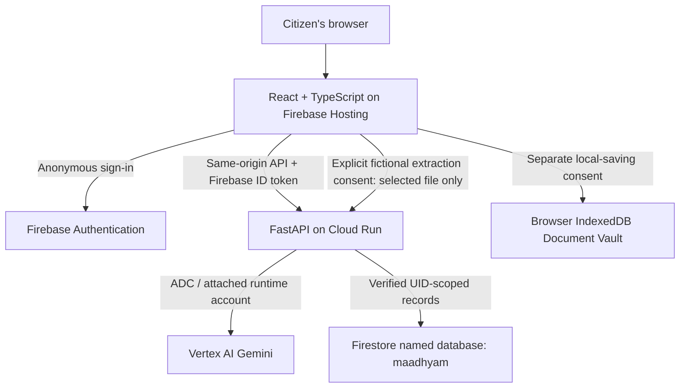
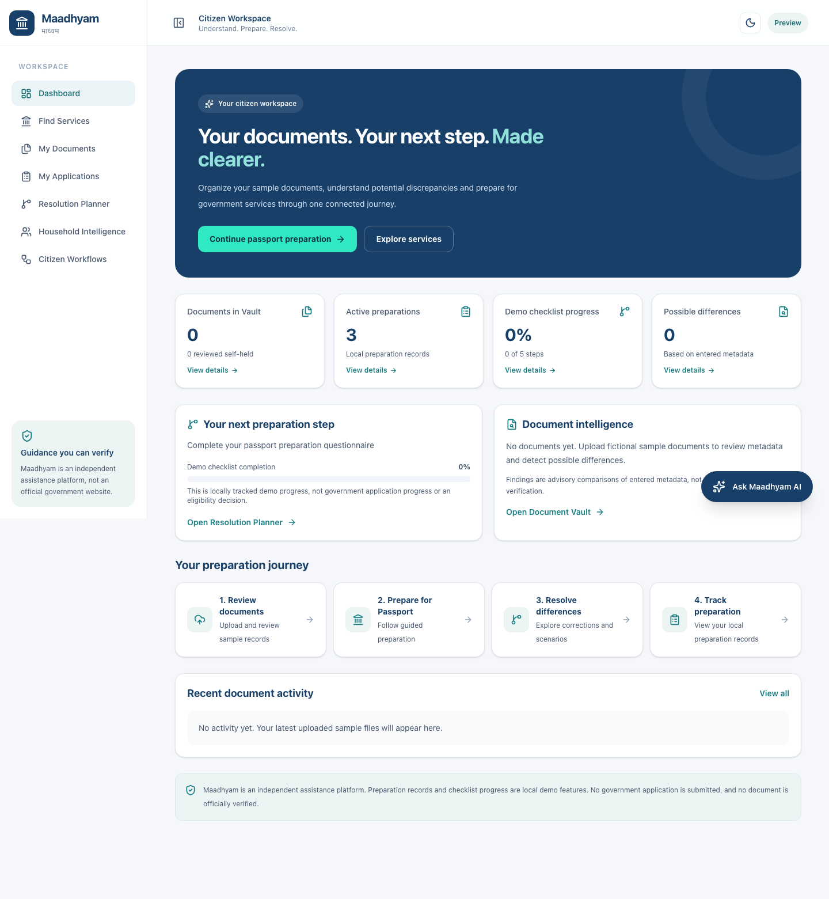

# Maadhyam (माध्यम)

**A connected preparation workspace for Indian citizens navigating documents and government services.**

[Open the live demo](https://maadhyam-1610.web.app) · [Submission branch](https://github.com/swar186j/AIBuildercup-Initial/tree/main) · [M11 stabilization evidence](qa/M11_FINAL_REMEDIATION_REPORT.md)

Indian citizens often need to reconcile spelling variations, dates, addresses, missing supporting evidence and prerequisites across departments before they can apply for a service. Maadhyam helps organize that preparation: review documents, understand potential discrepancies, identify dependencies and save a practical next-step plan.

This is more than a general chat interface. Deterministic rules and evidence comparisons drive the checklists and dependency graphs; Gemini assists with fictional-document extraction and explanations. Findings remain traceable to entered evidence and source references, and users review proposed fields before applying them. Maadhyam does not submit or approve government applications.

## Try the demonstration

**https://maadhyam-1610.web.app** — no local server is needed. Use fictional information and the sample files in [`qa/fixtures`](qa/fixtures). Gemini is optional; most preparation and planning functions use deterministic logic.

> The hackathon application is available on `main`. Share the repository link above with judges.

## Implemented capabilities

| Area | What the application does |
|---|---|
| Document Vault | Upload PDF/PNG/JPEG samples, edit metadata, mark records self-reviewed and optionally persist files in browser-local IndexedDB. |
| Gemini extraction | Explicitly consent to processing one fictional document through FastAPI and Vertex AI; review validated proposed fields before applying. |
| Identity comparison | Compare Indian name variations, birth dates and addresses; inspect provisional or missing values and discrepancies. A flag does not establish which record is correct. |
| Passport Guided Journey | Choose an assistance type, select a named household applicant or Other, answer questions and inspect source-linked document guidance. |
| Rules-as-Code and checklists | Apply deterministic preparation rules and evidence categories; distinguish supporting-document candidates from verified official acceptance. |
| Household Intelligence | Organize members using unique IDs, confirm document-owner associations, retain distinct people with the same relationship, and inspect prerequisite graphs and cycles. Relationships remain unverified. |
| Resolution Planner | Turn findings and prerequisites into next steps; review target-date urgency, document expiry, blockers and dependent tasks. |
| Advanced reasoning | Explore deadlocks, proof-substitution candidates, what-if corrections, identity/name evolution, address continuity, minimum review sets and weighted paths. Example time/cost estimates are not government commitments. |
| Citizen workflows | Human assistance, life-event discovery, multi-department guidance, rejection diagnosis, legacy-record recovery, authority bottlenecks, deadline rescue and visit-reduction planning. These provide preparation guidance, not official system integrations. |
| AI assistant | Preserve the floating assistant for local evidence-based guidance or optional Gemini explanations using explicitly confirmed fictional metadata. |
| Cloud preparations | Consent to saving Passport answers, applicant details, selected document IDs and household/planner progress under a verified Firebase anonymous UID; refresh and resume the same record. File bytes are not stored in Firestore. |

## Architecture



The cloud project is `maadhyam-1610`. Cloud Run and Firestore use `asia-south1`; Gemini uses the `global` endpoint and `gemini-2.5-flash`. The runtime account is `maadhyam-api@maadhyam-1610.iam.gserviceaccount.com`. It uses attached credentials; no service-account JSON key is committed or required in the container.

Cloud Run has minimum instances **0**, maximum instances **2**, one CPU, 512 MiB memory and bounded concurrency/timeouts. Paid AI endpoints require Firebase authentication and have bounded inputs, outputs, attempts and per-instance admission limits. These controls are not hard spending caps. See the [deployment report](qa/M11_DEPLOYMENT_REPORT.md) and [billing owner instructions](qa/M11_BILLING_OWNER_ACTIONS.md).

## Local setup

The application lives inside `Maadhyam/`. Verified tooling: Python 3.13, `uv` 0.13 and Node.js 24. Install Git, `uv`, Node.js and npm first.

```powershell
git clone --branch main https://github.com/swar186j/AIBuildercup-Initial.git
cd AIBuildercup-Initial/Maadhyam/apps/api
uv sync --extra dev
Copy-Item .env.example .env
```

For local deterministic guidance without cloud credentials, set `MAADHYAM_GEMINI_VERTEXAI=false` in the ignored `.env` and leave `MAADHYAM_GEMINI_API_KEY` empty. Gemini will truthfully report that its provider is unavailable. Cloud saving requires authorized Google Cloud credentials and Firebase client configuration.

```powershell
uv run uvicorn maadhyam_api.main:app --host 127.0.0.1 --port 8000
```

In another terminal, from the repository root:

```powershell
cd Maadhyam/apps/web
npm ci
npm run dev -- --host 127.0.0.1
```

Open `http://127.0.0.1:5173`. Vite proxies `/api` to the local backend on port 8000. Keep the same hostname/browser profile when restoring anonymous preparations.

For authorized Vertex AI development, use `gcloud auth application-default login`; configure the existing settings rather than copying credentials into source. Required non-secret backend names are:

```text
MAADHYAM_GOOGLE_CLOUD_PROJECT
MAADHYAM_FIRESTORE_DATABASE_ID
MAADHYAM_GEMINI_VERTEXAI
MAADHYAM_GOOGLE_CLOUD_LOCATION
MAADHYAM_GEMINI_MODEL
MAADHYAM_AI_TIMEOUT_MS
MAADHYAM_CORS_ORIGINS
MAADHYAM_PRODUCTION
```

The example sets Firestore to **`maadhyam`**, not `(default)`. In `apps/web/.env.local`, configure `VITE_FIREBASE_API_KEY`, `VITE_FIREBASE_AUTH_DOMAIN`, `VITE_FIREBASE_PROJECT_ID` and `VITE_FIREBASE_APP_ID` using the Firebase web app's public configuration. Never put a Gemini/server secret or service-account credential in a `VITE_` variable. Production API requests use the same origin through Hosting rewrites.

### Run checks

```powershell
# From Maadhyam/apps/api
uv run --extra dev python -m pytest tests -q
# From Maadhyam/apps/web
npm run lint -- --max-warnings 0
npm run build
# From the repository root on Windows, after building the frontend
Maadhyam/apps/api/.venv/Scripts/python.exe qa/run_release_local.py
Maadhyam/apps/api/.venv/Scripts/python.exe qa/run_release_local.py qa/test_remediation.py
```

The browser runner owns its local API and Vite preview servers. Playwright's Chromium must be installed; if needed, run `uv run playwright install chromium` from `apps/api`. Comprehensive AI tests use mocks. Hosted QA writes only newly created fictional preparations; model calls must remain deliberate and limited. See [`qa/README.md`](qa/README.md) and the current remediation report for exact results and platform caveats.

## Fictional citizen walkthrough

1. Open the live application in a browser profile you can retain.
2. Add fictional household members, including two distinct people with the same relationship.
3. Upload fictional supporting documents to Document Vault.
4. Assign exact document holders and confirm permission for associations.
5. Review printed metadata and inspect potential name, DOB or address differences.
6. Start a Passport preparation from My Preparations or Services.
7. Select a household applicant, or choose Other and enter a fictional custom name.
8. Answer the questionnaire and inspect the document checklist and source-linked guidance.
9. Open Resolution Planner; change the personal target date and inspect dependencies and recommended actions.
10. Use Save preparation and explicitly consent to cloud storage. Household cloud saving also has a confirmation.
11. Refresh and resume the same record; enable separate Vault local-saving consent if the files should survive a refresh on this device.
12. Try the floating assistant. Only enable Gemini for fictional metadata; extraction separately requires fictional-file transmission consent.

## Safety and limitations

- Maadhyam is an independent preparation prototype, not an official government application portal. It performs no direct government submission and gives no eligibility, acceptance or approval guarantee.
- Source-linked rules and example estimates require independent verification through current official portals. A stored source reference does not certify that a government page is unchanged.
- Use fictional documents in the public demo. File bytes stay browser-local except when a user explicitly requests processing of a selected fictional file through the backend and Gemini.
- Local IndexedDB persistence is optional and is not encrypted by this application. Clearing browser data or changing devices can leave cloud references without their corresponding files.
- Firebase anonymous identity has recovery limitations. Household labels and ownership confirmations do not implement verified relationships or cross-account sharing permissions.
- AI output is untrusted assistance. Structured extraction is validated and requires human review; heuristic safety checks do not establish exhaustive hallucination or prompt-injection resistance.
- Durable distributed rate limiting, account recovery and additional official department integrations remain future work. No new infrastructure is needed for the current demonstration.

## Screenshot and release evidence

The existing empty-workspace screenshot below was inspected for personal data and tokens. It illustrates the retained dashboard design; current release verification is recorded separately in the QA report.



For a short judging walkthrough and submission pointers, see [the hackathon guide](HACKATHON.md). Reports: [current remediation](qa/M11_FINAL_REMEDIATION_REPORT.md), [initial deployment](qa/M11_DEPLOYMENT_REPORT.md), [test history](qa/M11_TEST_RESULTS.md), [rollback](qa/M11_ROLLBACK.md), [known limitations](qa/M11_KNOWN_LIMITATIONS.md).
