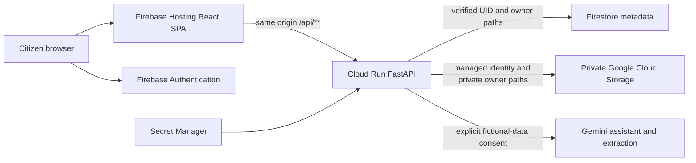

# Maadhyam architecture

Current execution is localhost SPA/API plus real Firebase Auth, Firestore and private Supabase. Cloud Run and Hosting are prepared but have not been deployed by this implementation.

The API derives UID from a verified Firebase ID token. Applications, planner, household and file metadata use owner-scoped Firestore paths. Mutations use optimistic revisions; creation IDs survive lost responses. The selected deployment stores files in a private GCS bucket behind authenticated API downloads. Existing local files remain Supabase-backed until the verified migration described in docs/GCS_MIGRATION.md. Browser persistence stores Firebase sessions and appearance preferences; document bytes, household data and preparations are held in memory and restored from cloud, with no local-save/import controls.

Document extraction requires explicit fictional-document confirmation. Assistant context contains reviewed applicant evidence and computed guidance; candidate and family evidence do not become official acceptance decisions. Gemini responses are advisory, extraction JSON is validated and fields require review. The shared provider transport uses a 20-second request timeout and at most two attempts for selected transient errors. Extraction runs in a thread pool. Production AI calls require Firebase authentication and have per-user and per-instance admission limits.

Operational logging omits paths, queries, document metadata, tokens and provider exception text. API responses are non-cacheable. Health is process liveness, not a claim of database/provider availability. No Google service-account JSON is required on Cloud Run: use its dedicated runtime identity.
